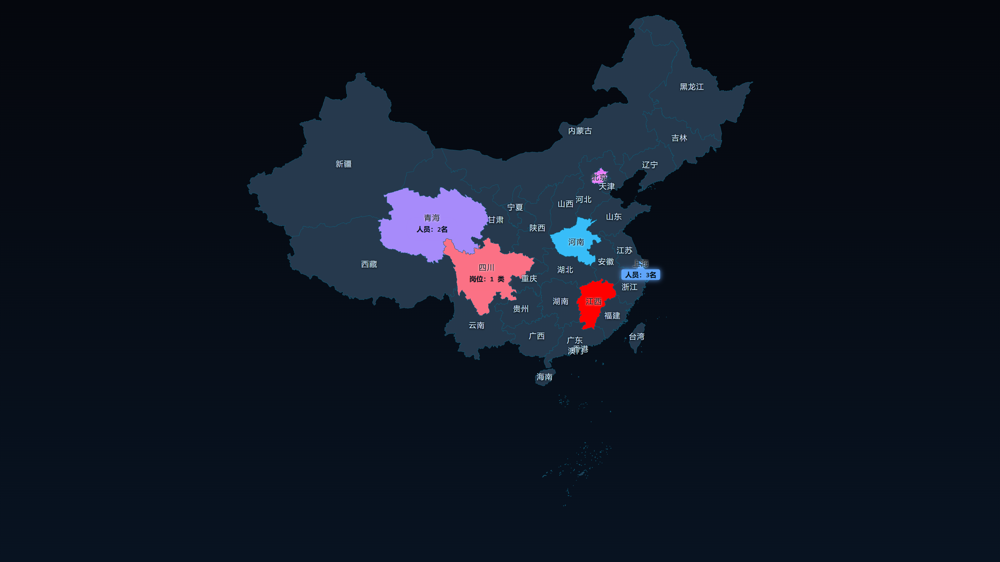

# 区域标注分布 · 全国

基于 **Vue 3 + SVG + D3** 的全国人员/区域分布可视化工具。用一张可缩放的中国矢量地图，按省 / 市两级给区域配色、标注人数、岗位和人员名单，并支持人员表格管理、键盘可搜索筛选、随机配色和所见即所得的高清 PNG / SVG 矢量导出。既可以作为纯网页运行，也可以打包成一个不依赖浏览器内核的 Windows 便携 exe。



---

## 目录

- [功能特性](#功能特性)
- [技术栈](#技术栈)
- [技术实现要点](#技术实现要点)
- [目录结构](#目录结构)
- [数据模型](#数据模型)
- [数据读写与本地服务](#数据读写与本地服务)
- [开发与构建](#开发与构建)
- [打包便携 exe](#打包便携-exe)
- [配置文件位置与注意事项](#配置文件位置与注意事项)

---

## 功能特性

### 地图浏览

- **全国省级矢量地图**：GeoJSON 边界 + `d3-geo` 墨卡托投影，SVG 路径渲染，清晰可缩放。
- **省 / 市两级视图**：
  - 省级视图展示 34 个省级行政区；
  - 点击省份或切换到「市」，加载该省下辖市 / 区边界，原省轮廓作为半透明背景；
  - 市级视图下可继续编辑该市 / 区的颜色与人员。
- **缩放与平移**：滚轮 / 拖拽缩放（1x–32x），点击区域自动聚焦，缩放时线宽保持稳定。
- **分组浏览**：内置「北一区」（北京、天津、河北、内蒙古、辽宁、吉林、黑龙江），只显示并缩放到该组，按区域视觉重心居中。
- **回到全国 / 重新加载配置**：一键复位视图或重新读取本地配置。

### 区域标注

- 每个区域可配置：
  - **区域颜色**（可从协调色板随机取色）；
  - **标注显示方式**：`地图标签`（常显在区域中心）或 `气泡展示`（点击区域后在重心弹出）；
  - **当前人数**；
  - **岗位列表**（岗位名称 + 人数）；
  - **人员名单**。
- **人员名单字段**：姓名、岗位、联系方式、备注、所属市 / 区、**负责医院列表**。
  - 一个人可以负责多家医院；
  - 每家医院可单独指定所在市 / 区，留空表示跟随人员所属市 / 区；
  - 因此同一个人可跨多个市 / 区负责医院。
- **市级面板的人员口径**：只展示「登记在本市 / 区」或「在本市 / 区有负责医院」的人员；在市级面板删除一个人表示**从本市 / 区解绑**，他在其他市 / 区的医院记录会保留，只有完全无归属时才整条删除。
- **人数自动同步**：人数留空时按名单人数显示；名单增删时，仅当人数为空或原本等于名单人数才自动跟随，手动填写的人数不会被覆盖。

### 人员表格管理

- 全量人员表格弹窗（`表格管理`），支持：
  - 按**省份**、**市 / 区**筛选；
  - 关键字搜索姓名 / 岗位 / 电话 / 备注 / 医院；
  - 新增、编辑、删除人员，换省时自动迁移；
  - 编辑表单内同样支持多医院、多市 / 区归属。
- 保存后直接写回本地配置，地图与右侧面板同步刷新。

### 展示与个性化

- **显示项开关**：分别控制地图标签（区域名称 / 人数 / 岗位 / 人员）和气泡内容（人数 / 岗位 / 人员）。
- **三套主题**：科技深色、浅色简约、暗紫霓虹，所有组件通过 CSS 变量联动换肤。
- **随机配色**：
  - `多彩随机`：每个带标注的区域从 13 色协调色板中取不同颜色，并尽量避免相邻撞色；
  - `同色渐变·浅到深 / 深到浅`：所有区域共用一个基色，按地图**横向位置**依次取浅 / 深色，整体形成跨区域的连续渐变；
  - 只对「有标注」的区域生效，无标注区域保持原样。
- **导出图片**：按当前视图导出 **2 倍分辨率 PNG** 或 **SVG 矢量图**（均含主题背景、区域填充、标签、当前气泡），文件名带时间戳；SVG 插入 PPT 后放大不模糊，还可取消组合单独改色 / 改字。
- **SVG 导出设置**：导出前可选范围（全部 / 仅带标注 / 仅选中 / 自定义勾选）、是否保留范围外轮廓、**2.5D 立体色块**及厚度、边界简化强度、**标注文字颜色**（跟随主题 / 预设色 / 自定义）、背景 / 标签 / 合并未标注区域。默认「标准简化 + 合并未标注」会把全国视图从约 345 KB / 34 个形状压到约 55 KB / 4 个形状，显著缓解 PPT 卡顿。
- **复制到剪贴板**：一键把当前视图复制为 SVG（同时附带 PNG 兜底），直接在 PPT 里 `Ctrl+V` 粘贴；也可在导出设置中按同一套选项复制，复制完成后面板保持打开，方便继续调整或再次复制。
- **设置持久化**：主题、显示项、随机配色模式保存在浏览器 `localStorage`。

### 桌面 / 离线分发

- **Electron 外壳**：内置本地 HTTP 服务加载 `dist`，通过 `BrowserWindow` 打开，单实例锁、外链走系统浏览器。
- **便携 exe**：C# / .NET Framework 编写的轻量启动器，静态资源以 zip 内嵌进 exe，运行后解压到 `%LOCALAPPDATA%`，启动本地服务并用**系统默认浏览器**打开，不携带 Chromium，exe 约 19 MB。

---

## 技术栈

| 层次 | 技术 |
| --- | --- |
| 前端框架 | Vue 3.2（`<script setup>` / Composition API） |
| 构建工具 | Vue CLI 5（webpack 5）、Babel、ESLint |
| 地图投影 | `d3-geo`（`geoMercator`） |
| 交互缩放 | `d3-zoom`、`d3-selection` |
| 图形渲染 | 原生 SVG（区域、标签、气泡）+ Canvas 2D（PNG 导出）+ SVG 字符串（矢量导出） |
| 地理数据 | GeoJSON（省级 / 市级边界）、行政区划索引 JSON |
| 数据持久化 | 本地 JSON 文件 + HTTP 接口（开发中间件 / Electron / C# 服务） |
| 桌面外壳 | Electron 45（可选） |
| 便携启动器 | C# / .NET Framework 4.x + 内嵌 zip 资源 |
| 打包脚本 | Node.js + PowerShell `Compress-Archive` + `csc.exe` |
| 可选工具 | Python `python-pptx`（生成说明 PPT） |

---

## 技术实现要点

### 1. 投影自适应与视觉重心

- `fitProjection()` 先用一个探针投影计算全国范围，再按容器尺寸等比缩放并居中，四周留 24px padding。
- 标签位置使用多边形**面积质心**（`featureAreaCentroid`），而不是包围盒中心，避免新疆、内蒙古等狭长区域标签偏移。
- 分组视图用「面积加权视觉重心」作为聚焦点，而不是简单包围盒中心。

### 2. 缩放与动态平移边界

- `d3-zoom` 管理缩放状态，组件用 `zoomState` 同步 SVG `transform` 与 HTML 标签层位置。
- 区域描边使用 `vector-effect: non-scaling-stroke`，放大后边线不会变粗。
- `translateExtent` 会随当前视图动态调整：
  - 全国视图使用全国范围；
  - 市级视图使用所属省范围；
  - 分组视图使用分组范围；
  - 并随缩放实时更新，避免贴近图边的分组（如北一区）拖动时被锁死。
- 标签/气泡不吃鼠标事件（`pointer-events: none`，关闭按钮单独放开），保证地图拖拽流畅。

### 3. 标签与气泡

- 标签在独立的 HTML 层渲染，位置由 `区域中心 × 当前缩放 + 平移` 计算，和 SVG 保持像素级对齐。
- 文字统一使用主题文字色 + 背景色 `text-shadow` 描边，保证落在任意区域颜色上都可读。
- 气泡固定居中于区域重心，靠近视口边缘时自动整体收拢；岗位按两列窄卡片排布，超长名称省略号 + `title` 提示。

### 4. 所见即所得图片导出（PNG / SVG）

- 导出时按当前视图还原：主题渐变背景、区域填充、选中描边、标签、气泡全部与页面布局一致。
- **PNG**：在 Canvas 中重绘，使用 `Path2D` 复用 SVG 路径，按当前 `scale / translate` 变换；倍率默认 2x。
- **SVG**：直接拼接 SVG 字符串（`<path>` 区域 + `<text>` 标签 / 气泡），区域描边按缩放倒数补偿，输出真正的矢量图，插入 PPT 后可无损缩放、取消组合编辑。
- **SVG 导出设置**（`ExportDialog.vue`）：
  - 范围：全部区域 / 仅带标注 / 仅选中 / 自定义勾选，未选中的区域可按需合并为浅色上下文轮廓；
  - 立体：按厚度参数把每个区域向下复制一份暗色底面，所有底面先于顶面绘制，导出即完成 2.5D 效果，无需在 PPT 里加三维格式；
  - 边界简化：Ramer–Douglas–Peucker（RDP）按最终图像像素容差精简，容差再除以当前缩放比例，因此放大后导出仍保留细节；
  - 合并：未标注区域合并进同一个 `<path>`，全国视图的形状数从 34 降到 4；
  - 标签：每个文字只生成一个纯 `<text>`，同时写 `fill` 属性与 `style="fill:…;stroke:none"`，不使用 `paint-order` 或文字描边 —— PowerPoint 不支持 `paint-order`，描边会覆盖在文字上，导致标注颜色（尤其浅色主题）在 PPT 里发白；
  - 标注颜色：可覆盖标签与气泡正文的填充色，气泡标题仍沿用区域颜色，方便在 PPT 中统一文字色。
- 两种格式共用同一套标签 / 气泡布局与文本测量，保证位置、换行、省略一致。
- 自实现圆角矩形、中文字符逐字换行（`wrapCanvasText`）和超宽省略（`fitCanvasText`）。
- 「复制到剪贴板」优先写入 `image/svg+xml`，同时附带 `image/png` 兜底；PPT 不支持 SVG 剪贴板时自动使用 PNG。
- 实测（全国视图、标准简化）：原始导出约 **345 KB / 34 个路径 / 约 2.5 万个坐标点**；默认合并后约 **55 KB / 4 个路径 / 约 3.6 千个坐标点**，体积下降约 84%，坐标点下降约 85%。

### 5. 配置规范化与市级子集合并

- `normalizeConfig()` 统一清洗数据：`color`、`display`、`headcount`、`positions`、`roster`，忽略旧版 `items / attrs` 结构，空数组不落盘。
- 人员数据始终存放在**所属省**的配置里；市级只保存颜色 / 展示方式。
- 市级面板编辑时记录每行对应的省级名单下标（`originIndices`），保存时按 `edits / removals` 合并：
  - 修改的行原地替换；
  - 删除的行调用 `detachFromCity()`，只解除本市 / 区归属和本市 / 区医院；
  - 其他市 / 区的人员与医院保持不变。

### 6. 配色算法

- `RANDOM_PALETTE` 提供 13 个中高明度、相近饱和度的协调色。
- 多彩随机使用 Fisher–Yates 洗牌，并跳过与上一个区域相同的颜色。
- 同色渐变先计算基色的更浅 / 更深色，再按区域数量线性插值（`gradientShades`），区域排序由地图当前横向坐标决定（`sortByPosition`）。

### 7. 可搜索下拉组件

- `SearchSelect.vue` 自研实现，支持：
  - 输入关键字过滤、按省分组；
  - 匹配到省名时保留该省全部市 / 区；
  - 上下键 / 回车 / Esc 键盘操作；
  - `position: fixed` 浮层定位，自动上下翻转并防止被滚动容器裁切；
  - 点击外部关闭、视口滚动 / 缩放时重新定位。

### 8. 三端统一的配置读写

- 前端只依赖 `data/region-config.json`（读）和 `api/region-config`（写）两个地址。
- 开发模式由 `vue.config.js` 的 `onBeforeSetupMiddleware` 提供写接口，写入 `public/data/region-config.json`。
- Electron / 便携 exe 由本地 HTTP 服务拦截同一路径，写入用户数据目录。
- 开发服务器关闭了 `public/` 静态文件监听，避免保存配置后整页刷新冲掉面板状态；手动改文件后点击「重新加载配置」即可。

### 9. 便携 exe 设计

- `scripts/build-portable.js` 用 PowerShell 将 `dist` 压缩为 `web.zip`，再用 `csc.exe` 把它作为资源编译进 `Launcher.cs`。
- 启动时将资源解压到 `%LOCALAPPDATA%\StaffDistributionMap\web`，用 exe 大小 + 修改时间做版本戳，exe 更新后自动重新解压。
- 优先监听固定端口 **17890**：浏览器按「协议 + 主机 + 端口」隔离 `localStorage`，端口固定才能保留主题、显示项等设置；端口被占用时退回随机端口。
- 服务端实现静态文件、MIME、目录穿越防护、`GET /data/region-config.json`、`GET/POST /api/region-config`、请求体大小限制和格式化 JSON 写盘。

---

## 目录结构

```text
staffdistribution/
├─ src/
│  ├─ App.vue                     # 页面骨架、工具栏、视图状态、保存/配色/导出编排
│  ├─ main.js                     # Vue 入口
│  ├─ components/
│  │  ├─ ChinaMap.vue             # SVG 地图、投影、缩放、标签、气泡、PNG / SVG 导出
│  │  ├─ RegionPanel.vue          # 区域标注编辑面板（颜色/人数/岗位/名单/医院）
│  │  ├─ ExportDialog.vue         # SVG 导出设置（范围/立体/简化/合并）
│  │  ├─ RosterManager.vue        # 人员表格管理（筛选、搜索、增删改）
│  │  └─ SearchSelect.vue         # 可搜索、分组、键盘操作的下拉选择器
│  └─ composables/
│     ├─ useDivisions.js          # 区划与配置加载、数据规范化、保存
│     ├─ useTheme.js              # 三套主题及 localStorage 持久化
│     ├─ useDisplayOptions.js     # 标签/气泡显示项开关
│     ├─ useColorMode.js          # 随机配色模式
│     └─ colorPalette.js          # 协调色板、洗牌、同色渐变算法
├─ public/
│  ├─ data/region-config.json     # 业务数据：区域标注与人员名单
│  ├─ map/divisions/
│  │  ├─ all-divisions.json       # 省/市/区索引（3238 条）
│  │  ├─ provinces.json           # 省级 GeoJSON（34 省 + 全国边界 100000_JD）
│  │  ├─ cities/<adcode>.json     # 各省下辖市/区 GeoJSON
│  │  ├─ boundary/                # 更细粒度边界原始数据
│  │  └─ counties/                # 区县边界原始数据
│  ├─ index.html
│  └─ app-icon.ico
├─ electron/
│  └─ main.js                     # Electron 主进程：本地 HTTP + BrowserWindow
├─ server/
│  └─ Launcher.cs                 # 便携 exe 的 C# 启动器与静态服务器
├─ scripts/
│  ├─ build-portable.js           # 打包便携 exe
│  ├─ build-ppt.py                # 生成操作说明 PPT（可选）
│  ├─ png-to-ico.ps1              # PNG 转 ICO
│  └─ ppt-assets/                 # README / PPT 截图
├─ vue.config.js                  # 开发服务器与配置写回接口
└─ package.json
```

---

## 数据模型

业务数据保存在 `public/data/region-config.json`，顶层以**行政区 adcode** 为键：

```json
{
  "110000": {
    "color": "#adb2df",
    "display": "label",
    "headcount": 2,
    "positions": [
      { "name": "总代理", "count": 1 },
      { "name": "二级代理", "count": 1 }
    ],
    "roster": [
      {
        "name": "李xx",
        "position": "总代理",
        "phone": "131xxxxx",
        "note": "负责的医生有xxx",
        "city": "110114",
        "hospitals": [
          { "name": "北大国际", "city": "110114" },
          { "name": "海淀医院", "city": "110108" },
          { "name": "协和医院", "city": "" }
        ]
      }
    ]
  }
}
```

| 字段 | 说明 |
| --- | --- |
| `color` | 区域填充色；为空时使用主题默认色 |
| `display` | `label` = 地图常显标签；`bubble` = 点击后显示气泡 |
| `headcount` | 当前地区人数；留空时按名单人数展示 |
| `positions` | 岗位列表 `{ name, count }` |
| `roster` | 人员名单数组 |
| `roster[].city` | 人员所属市 / 区 adcode，可为空 |
| `roster[].hospitals` | 负责医院 `{ name, city }`，`city` 可为空，表示跟随人员所属市 / 区 |

> 人员数据统一挂在**省级**配置下；市级配置通常只保存 `color` / `display`。读取时会自动规范化，旧版 `items / attrs` 字段会被忽略。

---

## 数据读写与本地服务

前端统一使用两个地址：

| 地址 | 方法 | 说明 |
| --- | --- | --- |
| `data/region-config.json` | GET | 读取当前配置 |
| `api/region-config` | POST | 保存整份配置（JSON 对象） |

不同运行方式的实现：

- **开发模式**：`vue.config.js` 中的 `onBeforeSetupMiddleware` 提供 `POST /api/region-config`，写入 `public/data/region-config.json`；读取走静态文件。
- **Electron**：`electron/main.js` 启动本地 HTTP 服务，`GET/POST /api/region-config` 与 `GET /data/region-config.json` 均读写 `%APPDATA%\staffdistribution\region-config.json`。
- **便携 exe**：`server/Launcher.cs` 提供相同接口，读写 `%APPDATA%\StaffDistributionMap\region-config.json`。

接口约束：

- 只接受 JSON **对象**，数组或其他类型返回 400；
- 请求体有大小限制（开发 / Electron 5 MB，exe 8 MB）；
- 写盘时统一格式化缩进，方便手工编辑。

---

## 开发与构建

### 环境要求

- Node.js（建议 18+）
- npm
- 打包 exe 额外需要 Windows 自带的 **.NET Framework 4.x**（`csc.exe`）

### 安装依赖

```bash
npm install
```

### 本地开发（热更新）

```bash
npm run serve
```

默认访问 `http://localhost:8080`。开发服务器已关闭 `public/` 静态文件监听，保存配置不会触发整页刷新。

### 生产构建

```bash
npm run build
```

产物输出到 `dist/`，`publicPath` 为 `./`，可直接用任意静态服务器托管。

### 代码检查

```bash
npm run lint
```

### 可选：以 Electron 方式运行

需先 `npm run build` 生成 `dist/`，然后：

```bash
npx electron .
```

Electron 主进程会启动本地 HTTP 服务并打开桌面窗口；开发时也可通过 `ELECTRON_START_URL` 指向本地开发服务器。

### 可选：生成说明 PPT

```bash
py -3.13 scripts/build-ppt.py
```

依赖 `python-pptx`，输出项目根目录的 `map.pptx`。

---

## 打包便携 exe

```bash
# 先构建 dist，再打包
npm run build:exe

# 或者复用已有的 dist
npm run exe
```

产物：`release/StaffDistributionMap-<version>.exe`。

工作流程：

1. PowerShell 将 `dist/` 压缩为 `build/web.zip`；
2. 使用 `csc.exe` 把 `web.zip` 作为嵌入资源编译 `server/Launcher.cs`，并写入 `public/app-icon.ico` 图标；
3. 双击 exe 后：解压网页资源 → 启动本地服务 → 自动打开系统默认浏览器。

> exe 运行时固定使用 `http://127.0.0.1:17890/`；端口被占用时回退到随机端口（此时浏览器 `localStorage` 中的主题等设置会另存一份）。

---

## 配置文件位置与注意事项

| 运行方式 | 配置文件 |
| --- | --- |
| 开发模式 | `public/data/region-config.json` |
| Electron | `%APPDATA%\staffdistribution\region-config.json` |
| 便携 exe | `%APPDATA%\StaffDistributionMap\region-config.json` |

- `public/data/region-config.json` 是当前的**真实业务数据**，修改或覆盖前请先备份。
- 主题、显示项、随机配色模式只保存在浏览器 `localStorage`，不写入区域配置。
- 便携 exe 仅支持 Windows（依赖 .NET Framework 4.x）；网页与 Electron 版本跨平台。
- `public/map/divisions/boundary/`、`counties/` 为更细粒度的原始边界数据，当前运行时主要使用 `provinces.json` 与 `cities/*.json`。
- `scripts/1` 为早期打包脚本副本，实际使用 `scripts/build-portable.js`。
